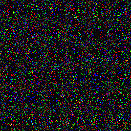
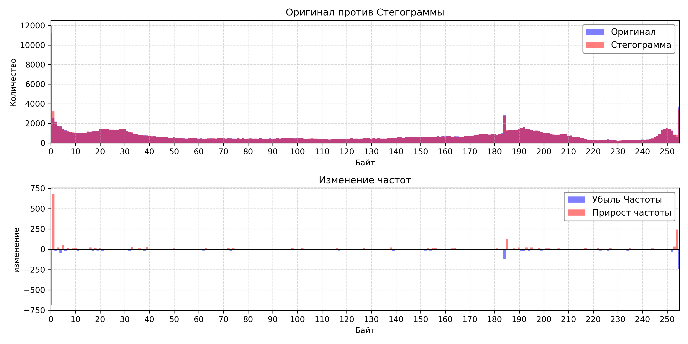

# Отчет по лабораторной работе по криптографии

---

## 1. Постановка задачи

- **Реализованные методы встраивания:**
  - Последовательное встраивание сообщения в открытом виде в младшие биты цветовых каналов изображения начиная с первого доступного байта (`PlainLSB`).
  - Последовательное встраивание сообщения, предварительно зашифрованного симметричным алгоритмом блочного шифрования AES-128 (`PlainCipherLSB`).
  - Встраивание зашифрованного текста (AES-128) со случайным распределением бит по изображению по псевдослучайным координатам на основе seed-ключа (`RandLSB`).
- **Использованные изображения:** градиент, шахматная доска, шум, собственное изображение.
- **Встраиваемые сообщения:** произвольный сгенерированный текст с размерами 50% и 100% от доступной вместимости исходного изображения.

## 2. Реализация

### Встраивание

1. Исходное изображение представлено массивом байт формата RGBA (4 байта на пиксель). Альфа-канал игнорируется: адресация пропускает каждый 4-й байт по формуле `pixelIdx = pos / 3 * 4 + (pos % 3)`.
2. Биты сообщения извлекаются от старшего к младшему: `(byte >> (7 - i % 8)) & 1`.
3. Замена младшего бита выполняется с помощью маски `0xFE`:
   `stego[pixelIdx] = (stego[pixelIdx] & 0xFE) | secretBit`
   (обнуление младшего бита и побитовое сложение).
4. При извлечении младший бит считывается операцией `bit = imgPixels[pixelIdx] & 1` и собирается в байты через побитовый сдвиг.

### Хранение длины

- В начало сообщения добавляется 4-байтный заголовок (тип `uint32`, порядок байт Big-Endian), содержащий размер сообщения в байтах.
- При декодировании алгоритм сначала считывает первые 4 байта, восстанавливает точную длину сообщения, а затем извлекает указанное количество байт из изображения.

### Проверка вместимости

- Доступная вместимость изображения в битах рассчитывается по трем цветовым каналам, исключая альфа-канал:  
  `capacityBits = (len(imageBytes) / 4) * 3`
- Перед записью проверяется условие: `totalBits = (len(payload) + 4) * 8 <= capacityBits`.  
  Если длина данных с учётом заголовка превышает лимит, функция возвращает ошибку.

### Шифрование

- Для режимов `PlainCipherLSB` и `RandLSB` исходный текст предварительно зашифровывается алгоритмом AES-128 из 1-й лабораторной работы.
- В качестве сообщения передаётся полученный шифротекст; заголовок длины содержит размер уже зашифрованных данных.

### Другие служебные данные

Для алгоритмов с AES-шифрованием соль и вектор инициализации IV записываются в сам исходный текст, который передаётся на стегографию.

### Псевдослучайный порядок позиций

1. Из переданного пароля формируется хеш SHA-256.
2. Первые 8 байт хеша преобразуются в 64-битное число (`uint64`), которое используется как `seed` для генератора `math/rand`.
3. Функция `rng.Perm(capacityBits)` (алгоритм тасования Фишера — Йетса) создаёт случайную перестановку индексов всех доступных позиций изображения.
4. Биты заголовка и сообщения последовательно встраиваются в координаты, определяемые полученным массивом перестановок.

## 3. Методика эксперимента

### Объем данных

- Эксперимент проводился на изображениях формата PNG с разрешением 512×512 пикселей (RGBA).
- Доступный объём изображения по каналам RGB составляет 786 432 бита (98 304 байта).
- В качестве текста для встраивания использовался сгенерированный псевдослучайный текст.

### Уровни заполнения

Сравнивались два фиксированных сценария нагрузки:

- **50% ёмкости** — частичное заполнение контейнера (~49 152 байта полезной нагрузки).
- **100% ёмкости** — предельное заполнение контейнера (~98 300 байт с учётом 4 байт заголовка длины).

### Рассчитываемые метрики

1. **Метрики искажения изображения:**
   - **PSNR (Peak Signal-to-Noise Ratio):** пиковое отношение сигнала к шуму (в дБ). Показывает уровень визуального шума от изменений: чем выше значение, тем незаметнее искажения для глаза (значения выше 40 дБ считаются визуально неотличимыми от оригинала).
   - **SSIM (Structural Similarity Index):** индекс структурного сходства (шкала от 0 до 1). Оценивает искажение контуров, текстур и яркости: значение 1.0 означает полное совпадение с оригиналом.
   - **Changed Ratio:** доля цветовых байт RGB, реально изменивших своё значение (в теории LSB перезаписывается около половины от объёма внедряемых данных, так как остальные биты уже совпадали).
2. **Метрики стегоанализа:**
   - **P(LSB=1):** вероятность появления единицы в младших битах. Оценивает баланс бит: для зашифрованных данных или шума значение близко к 0.5, а в обычном тексте наблюдается перекос в сторону нулей ($P(\text{LSB}=1) < 0.5$).
   - **Критерий $\chi^2$ (тест Вестфельда по парам значений):** оценка разницы частот между соседними четными и нечетными значениями ($2k$ и $2k+1$, например 100 и 101). В оригинале эти частоты естественно различаются (высокий $\chi^2$), а при LSB-внедрении псевдослучайных бит они искусственно выравниваются, из-за чего значение $\chi^2$ резко падает.
   - **p-value:** вероятность получить наблюдаемое расхождение частот при справедливости нулевой гипотезы $H_0$ о равенстве соседних пар значений $(2k, 2k+1)$. В тесте Вестфельда используется стандартный уровень значимости критерия Пирсона $\alpha = 0.05$: если $p \le 0.05$, гипотеза о равенстве пар отвергается (распределение естественное); если $p > 0.05$, оснований отвергнуть $H_0$ нет. Поскольку в исходных изображениях парное равенство встречается крайне редко, значение $p > 0.05$ выступает статистическим индикатором искусственного выравнивания младших бит. Однако не является абсолютным доказательством вложения.

### Основное изображение для эксперимента

Основной эксперимент производился над собственным изображением photo.png.

## 4. Результаты

### Сводная таблица экспериментальных данных

| Метод | Заполнение | PSNR, дБ | SSIM | Changed Ratio | P(LSB=1) | $\chi^2$ | p-value |
| :--- | :---: | :---: | :---: | :---: | :---: | :---: | :---: |
| `Cover` | 0% | $+\infty$ | 1.0000 | 0.0000 | 0.4746 | 9456.69 | 0.0000 |
| `PlainLSB` | 50% | 54.18 | 0.9997 | 0.2483 | 0.4775 | 1504.82 | 0.0000 |
| `PlainCipherLSB` | 50% | 54.17 | 0.9997 | 0.2491 | 0.4916 | 1192.52 | 0.0000 |
| `RandLSB` | 50% | 54.17 | 0.9996 | 0.2490 | 0.4849 | 2446.03 | 0.0000 |
| `PlainLSB` | 100% | 51.15 | 0.9993 | 0.4989 | 0.4698 | 838.33 | 0.0000 |
| `PlainCipherLSB` | 100% | 51.15 | 0.9993 | 0.4993 | 0.4990 | 112.89 | 0.8102 |
| `RandLSB` | 100% | 51.14 | 0.9993 | 0.4997 | 0.5000 | 111.84 | 0.8290 |

---

### Графический анализ

#### Карта разности

*Рис. 1. Абсолютная попиксельная разность между исходным изображением и полученной стегограммой.*

- При последовательном встраивании (`PlainLSB`, `PlainCipherLSB`) область модификаций локализована в верхней части растра (при 50% заполнения) либо занимает всю площадь (при 100%).
- При псевдослучайном распределении (`RandLSB`) изменённые пиксели рассеяны по всему пространству кадра, не образуя непрерывных геометрических областей модификации.

#### Сравнительные гистограммы частот значений байтов

*Рис. 2. Макрораспределение частот байтов (вверху) и распределение попарных приращений частот $\Delta = \text{Stego} - \text{Cover}$ (внизу).*

- **Верхний график:** профили частот оригинала и стегоконтейнера визуально совпадают, сохраняя форму распределения яркостей без макросдвигов тональности.
- **Нижний график:** детально отображает динамику изменений $\Delta$. Каждому положительному приращению частоты в паре сопутствует симметричное отрицательное отклонение смежного значения ($2k \leftrightarrow 2k+1$), иллюстрируя эффект выравнивания пар значений.

## 5. Анализ

### Визуальная незаметность (PSNR и SSIM)

- Значения PSNR и SSIM практически идентичны для всех трёх методов при одинаковом объёме нагрузки (`54.17–54.18 дБ` и `0.9996–0.9997` при 50%; `51.14–51.15 дБ` и `0.9993` при 100%). Способ подготовки данных (открытый текст или шифротекст) и траектория записи (последовательная или псевдослучайная) не влияют на общий уровень вносимых искажений.
- Наиболее высокие значения PSNR и SSIM достигаются при 50% заполнении (минимальное число изменённых пикселей), наиболее низкие — при 100% заполнении. При этом даже в худшем случае SSIM остаётся выше 0.999, а PSNR уверенно превышает порог 40 дБ — искажения остаются полностью незаметными для человеческого глаза.

### Доля изменённых компонент (Changed Ratio)

- Показатель строго согласуется с теоретической вероятностью $P = 0.5$: так как исходный младший бит пикселя совпадает со встраиваемым битом примерно в половине случаев, физической перезаписи подвергается только половина затронутых компонент.
- При заполнении 50% контейнера изменяется около 25% всех RGB-компонент (`Changed Ratio` от `0.2483` до `0.2491`).
- При заполнении 100% изменяется около 50% компонент (`Changed Ratio` от `0.4989` до `0.4997`).
- Небольшие отличия между методами (в пределах 0.08%) объясняются тем, что в каждом случае встраивается разный набор бит (исходный текст или шифротекст) либо меняются координаты записи, поэтому число перезаписанных байт незначительно колеблется около среднего значения.

### Распределение значений младших бит (P(LSB=1))

- **Исходное изображение (`Cover`):** В отличие от равномерного шума, собственное изображение имеет естественную асимметрию младших бит ($P(\text{LSB}=1) = 0.4746$).
- **В методе `PlainLSB`:** При 50% заполнении показатель меняется незначительно (`0.4775`), а при 100% заполнении вероятность $P(\text{LSB}=1)$ снижается до `0.4698` из-за преобладания нулевых бит в кодировке ASCII. Это сохраняет заметный перекос в сторону нулей и служит демаскирующим признаком первого порядка.
- **В методах `PlainCipherLSB` и `RandLSB`:** Использование шифрования AES-128 обеспечивает высокую энтропию потока данных. При 50% заполнении смешивание шифротекста с исходными пикселями сдвигает $P(\text{LSB}=1)$ ближе к середине (`0.4916` и `0.4849`), а при 100% заполнении вероятность выравнивается до `0.4990` и `0.5000`. Для одномерных проверок без оригинала такой баланс выглядит естественно, однако сам факт принудительного выравнивания битового соотношения от `0.4746` к `0.5000` приводит к симметрии пар $(2k, 2k+1)$, которую при 100% заполнении фиксирует тест Вестфельда.

### Статистическая стойкость ($\chi^2$ и p-value)

- **Встраивание открытого текста (`PlainLSB`):** Исходное изображение обладает ярко выраженной естественной разницей частот между чётными и нечётными значениями ($\chi^2 = 9456.69$). Встраивание открытого текста частично сглаживает экстремальные пики гистограммы оригинала ($\chi^2$ снижается до **1504.82** при 50% и **838.33** при 100%), однако из-за неравномерной частотности символов ASCII выравнивания пар $(2k, 2k+1)$ не происходит: $\chi^2$ остаётся многократно выше числа степеней свободы ($df = 127$), а $p$-value равно `0.0000`. В сочетании с перекосом $P(\text{LSB}=1) = 0.4698$ это позволяет выявить наличие нешифрованного текста.
- **Выравнивание пар значений при шифровании (`PlainCipherLSB` и `RandLSB`):**
  - В расчёте критерия $\chi^2$ все 256 возможных значений байта делятся на 128 соседних пар $(2k, 2k+1)$, что задаёт $df = 128 - 1 = 127$ степеней свободы. В статистике значение $\chi^2 \le df$ ($\approx 127$) означает, что частоты внутри пар практически равны между собой.
  - В исходном изображении (`Cover`) соотношение чётных и нечётных байт сильно неравномерно, поэтому $\chi^2 = 9456.69$, а $p\text{-value} = 0.0000$.
  - Шифротекст AES-128 состоит из равномерно распределённых нулей и единиц. При перезаписи младших бит он искусственно выравнивает количество чётных и нечётных значений внутри каждой пары $(2k, 2k+1)$.
  - При 50% заполнении половина пикселей контейнера остаётся нетронутой, поэтому $\chi^2$ остаётся значительно выше 127 — **1192.52** для `PlainCipherLSB` и **2446.03** для `RandLSB` ($p\text{-value} = 0.0000 < 0.05$). При 100% заполнении выравниваются все пары по всему изображению: $\chi^2$ падает ниже числа степеней свободы — до **112.89** и **111.84**, из-за чего $p$-value возрастает до **0.8102** и **0.8290**. Превышение стандартного уровня значимости $\alpha = 0.05$ ($p > 0.05$) означает, что гипотеза о равенстве пар значений не отвергается, что служит признаком возможного наличия скрытых данных.

### Влияние шифрования на статистическую заметность

Предварительное шифрование AES-128 оказывает двойственный эффект на заметность стегограммы:

- Шифротекст выравнивает баланс бит ($P(\text{LSB}=1) \approx 0.500$ при полном заполнении) и устраняет перекос, характерный для открытого текста (`PlainLSB`).
- При 50% заполнении оба зашифрованных метода удерживают глобальную статистику ниже порога значимости $\alpha = 0.05$ ($p\text{-value} = 0.0000$), так как естественная асимметрия гистограммы исходного изображения преобладает. Однако при 100% заполнении равномерный шифротекст выравнивает пары значений по всему кадру: $\chi^2$ падает до `112.89` и `111.84`, а $p$-value возрастает до `0.8102` и `0.8290`, что не позволяет отвергнуть гипотезу о равенстве пар и вызывает подозрение на встраивание текста в изображение.

### Влияние псевдослучайного размещения (`RandLSB`)

- Перемешивание координат записи не ухудшает визуальные метрики качества изображения — при одинаковом объёме нагрузки значения PSNR (`54.17 дБ` при 50% и `51.14 дБ` при 100%), SSIM (`0.9996` и `0.9993`), доли изменений (`Changed Ratio` `0.2490` и `0.4997`) и вероятности $P(\text{LSB}=1)$ (`0.4849` и `0.5000`) находятся на том же уровне, что и у `PlainCipherLSB`.
- **При 50% заполнении:** Оба зашифрованных метода не обнаруживаются глобальным тестом Вестфельда ($p\text{-value} = 0.0000 < 0.05$), однако между ними сохраняется принципиальная разница:
  - В `PlainCipherLSB` все изменения (`Changed Ratio` $= 0.2491$) сосредоточены в верхней половине кадра, где локальная плотность перезаписи достигает 100%. Из-за этого вложение легко выявляется при зональном стегоанализе верхней части изображения.
  - `RandLSB` равномерно рассеивает модификации по всей площади кадра, убирая чёткую границу на карте разности и снижая локальную плотность изменений вдвое. При этом из-за равномерного распределения нетронутых пикселей по всем бинам гистограммы сохраняется высокий показатель $\chi^2 = 2446.03$ ($p\text{-value} = 0.0000$), благодаря чему метод остаётся незаметным как для глобального, так и для зонального анализа.
- **При 100% заполнении:** `RandLSB` ($\chi^2 = 111.84$, $p\text{-value} = 0.8290$) и `PlainCipherLSB` ($\chi^2 = 112.89$, $p\text{-value} = 0.8102$) становятся статистически эквивалентными. Поскольку перезаписи подвергаются все доступные биты контейнера, порядок обхода пикселей перестаёт влиять на итоговую гистограмму — оба метода выявляются тестом Вестфельда ($p > 0.05$).

### Влияние роста объёма сообщения (Payload)

Увеличение объёма сообщения вдвое (с 50% до 100% ёмкости) закономерно усиливает все статистические и визуальные отклонения:

- **Доля изменений (`Changed Ratio`):** растёт линейно в 2 раза — с `~0.249` до `~0.500`.
- **Визуальные метрики:** PSNR падает на ~3 дБ (с `54.17–54.18` до `51.14–51.15 дБ`), а SSIM снижается с `0.9996–0.9997` до `0.9993`.
- **Статистическая заметность:** в `PlainLSB` вероятность $P(\text{LSB}=1)$ опускается до `0.4698`, а $\chi^2$ снижается до `838.33`, оставаясь значительно выше порога $df = 127$ ($p = 0.0000$). В зашифрованных методах (`PlainCipherLSB` и `RandLSB`) рост payload до 100% приводит к падению (до `112.89` и `111.84`), $p$-value возрастает с `0.0000` до `0.8102` и `0.8290`, а `RandLSB` теряет преимущество пространственной маскировки.

## 6. Итоговый вывод

В ходе эксперимента подтверждено, что стеганография на основе замены младшего значащего бита (LSB Replacement) обеспечивает высокую визуальную скрытность (PSNR > 51 дБ, SSIM > 0.999 даже при 100% заполнении контейнера), однако уязвима к статистическому стегоанализу.

### Статистические различия между исследованными методами

1. **`PlainLSB` (последовательное встраивание открытого текста):**
   - Наименее стойкий метод. Из-за преобладания нулевых бит в кодировке ASCII при полном заполнении нарушается битовый баланс контейнера ($P(\text{LSB}=1) = 0.4698$), а критерий $\chi^2$ остаётся многократно выше числа степеней свободы ($\chi^2 = 1504.82$ при 50% и $\chi^2 = 838.33$ при 100% при $df = 127$, $p\text{-value} = 0.0000$), что позволяет выявить скрытое сообщение даже при частичном заполнении.

2. **`PlainCipherLSB` (последовательное встраивание шифротекста):**
   - Предварительное шифрование AES-128 выравнивает битовый баланс при полном заполнении ($P(\text{LSB}=1) = 0.4990$), маскируя вложение от простейших частотных проверок.
   - При 50% заполнении глобальный тест Вестфельда не фиксирует аномалию ($\chi^2 = 1192.52$, $p\text{-value} = 0.0000 < 0.05$) за счёт нетронутой нижней половины изображения, но концентрация изменений в верхней части растра выдаёт вложение при локальном (зональном) анализе. При 100% заполнении равномерный шифротекст выравнивает пары значений по всему кадру, снижая $\chi^2$ до `112.89` и поднимая $p$-value до `0.8102` ($p > 0.05$).

3. **`RandLSB` (встраивание шифротекста по псевдослучайным координатам):**
   - При **50% заполнении** `RandLSB` показывает наилучшую стойкость: равномерное рассеивание бит по всей площади кадра убирает чёткую границу на карте разности, защищает контейнер от зонального стегоанализа и сохраняет высокий показатель $\chi^2 = 2446.03$ ($p\text{-value} = 0.0000 < 0.05$), оставаясь незаметным для глобального теста Вестфельда.
   - При **100% заполнении** метод статистически эквивалентен `PlainCipherLSB` ($\chi^2 = 111.84$, $p\text{-value} = 0.8290 > 0.05$), поскольку перезаписи подвергаются все доступные биты контейнера.